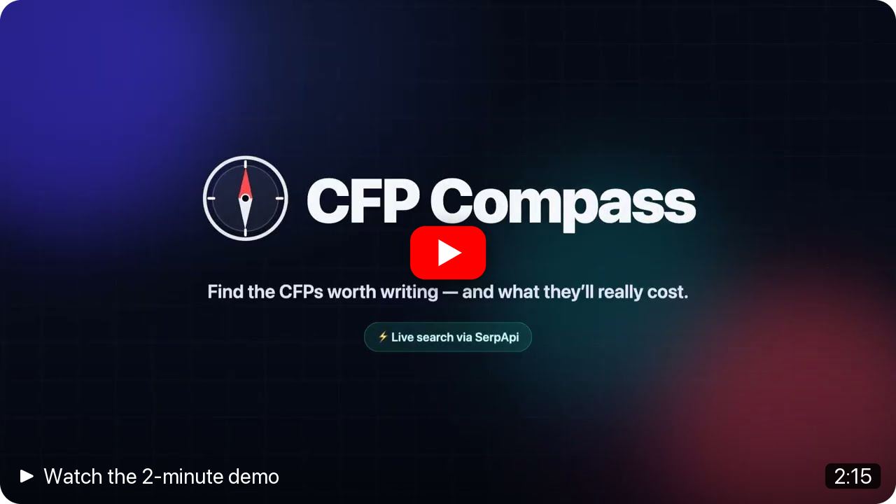
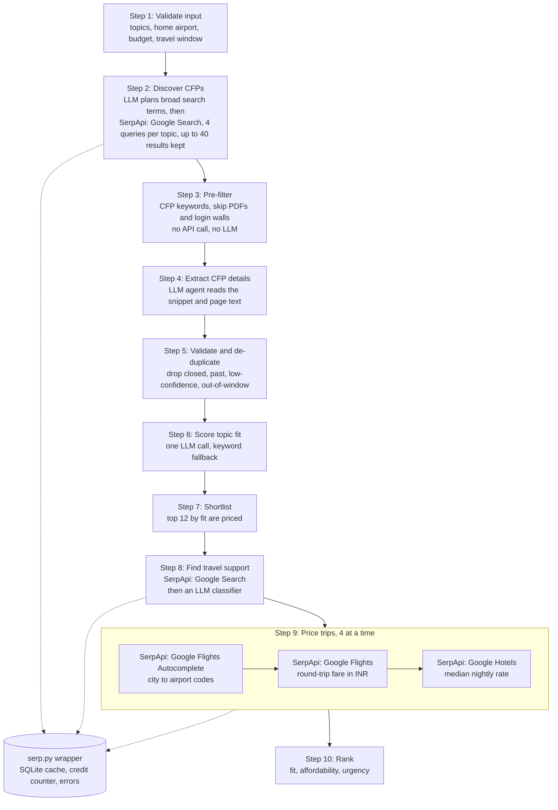

<h1 align="center">🧭 CFP Compass</h1>

<p align="center">
  <b>Find the conference talks worth writing, and know what each trip will really cost before you hit submit.</b>
</p>

<p align="center">
  
  
  
  
  
  
</p>

<p align="center">
  <a href="https://youtu.be/3JNIPseQ-hA" target="_blank" rel="noopener noreferrer" title="Watch the CFP Compass demo on YouTube">
    
  </a>
  <br>
  <sub><b>▶ <a href="https://youtu.be/3JNIPseQ-hA" target="_blank" rel="noopener noreferrer">Watch the 2-minute demo on YouTube</a></b></sub>
</p>

<p align="center">
  Built for the <b>SerpApi India Hackathon 2026</b> · AI Agents track
  <br>
  <a href="#-how-cfp-compass-uses-serpapi">SerpApi usage</a> ·
  <a href="#-how-it-works">How it works</a> ·
  <a href="#-setup">Setup</a> ·
  <a href="#-usage">Usage</a> ·
  <a href="#-design-decisions-and-limitations">Design decisions</a>
</p>

---

## ✨ What it does

CFP Compass is an AI agent that finds open conference calls for proposals (CFPs) matching your talk topics, then shows what each trip would really cost from your home city, in one ranked table.

In one click you get:

- **Open CFPs that fit your talk**, found across Sessionize, Pretalx and conference websites.
- **The real trip cost**: a live round-trip fare and hotel estimate in ₹, minus any speaker travel support.
- **A ranking you can trust**: every row explains why it ranks where it does, and every deadline quotes its source.


## 💡 The problem and the insight

> CFPs are spread across Sessionize, Pretalx and hundreds of conference websites, so finding the open ones that fit your talk takes hours.
> For a speaker in India, the deciding question is often not "will I get in?" but **"if I get accepted, what will the trip cost me?"**
> CFP Compass answers both at once, with live flight fares, live hotel rates and each conference's own speaker travel policy.

## 🎬 Demo video

**[Watch the 2-minute demo on YouTube](https://youtu.be/3JNIPseQ-hA).** It shows the app running locally: a real first run with live SerpApi searches, the ranked table, the evidence behind each deadline, and a re-run that uses 0 searches.

## 🔎 How CFP Compass uses SerpApi

Every search result and every price comes from SerpApi. Four engines are used, and Google Search does two jobs.

| Engine | What it does here | Why the product needs it |
| --- | --- | --- |
| **Google Search**: discovery | Finds open CFPs with 4 queries per topic. | CFPs have no shared feed or API; web search is the only way to find them all. |
| **Google Search**: travel policy | Finds each priced conference's speaker travel policy; an LLM classifies the top 5 results. | Travel support can turn a ₹1 lakh trip into ₹0. Each conference words it differently. |
| **Google Flights Autocomplete** | Turns the event city into airport codes and a city ID. | Flights need airport codes, but the city comes from free text on a web page. |
| **Google Flights** | Live round-trip economy fare in ₹ from your home airport, for the event dates. | For a speaker flying from India, the flight is usually the biggest cost. |
| **Google Hotels** | Median nightly rate near the venue, times the number of nights. | The other half of the trip cost, for the exact dates. |

<details>
<summary><b>Exact queries and parameters</b></summary>

- **Discovery.** One cached LLM call first turns each talk topic into the broad term conferences use ("Python concurrency" becomes "Python"). Then, per term (up to 2 topics): `"call for proposals" <term> conference <year>`, `"call for papers" <term> conference <year>`, `site:sessionize.com <term>` and `site:pretalx.com <term> cfp`, with `hl=en`, `gl=us`. `<year>` is this year and next (`2026 OR 2027`) until June, and next year only from July, when this year's calls have mostly closed. Reads `organic_results[]` (title, link, snippet, date).
- **Travel policy.** `"<conference name>" speaker travel OR "travel grant" OR "financial aid"`, top 5 results.
- **Airports.** `engine=google_flights_autocomplete`, `q=<city>, <country>`, `exclude_regions=true`; takes the first city suggestion's `id` (kgmid) and `airports[].id` (IATA).
- **Flights.** `engine=google_flights`, `type=1` (round trip), `currency=INR`, `gl=in`, `adults=1`, `travel_class=1`. Flies out the day before the event and back the day after. Reads `price_insights.lowest_price`, else the cheapest price in `best_flights[]` and `other_flights[]`.
- **Hotels.** `engine=google_hotels`, `q=hotels near <venue>, <city>, <country>`, same nights, `currency=INR`, `gl=in`. Median of the first 10 `rate_per_night.extracted_lowest` values.

</details>

### One wrapper for every call

Every SerpApi request goes through `search()` in [`cfp_compass/serp.py`](cfp_compass/serp.py), which handles three things:

- **Cache.** The key is the SHA-256 of the sorted request parameters without `api_key`. Responses live in a local SQLite file. Searches expire after 24 hours, flights and hotels after 6 hours, and airport lookups never expire.
- **Credit counter.** Each request SerpApi actually answers is counted and shown as "SerpApi searches used this run", next to the cache hits.
- **Graceful errors.** A failed lookup shows "unavailable" with a reason, and the run continues.
  - Timeouts, connection errors and 5xx answers are retried once; a timed-out search has usually finished at SerpApi, so the retry comes free from SerpApi's 1-hour cache.
  - On 401, 403 or 429, the rest of the run switches to cached results.
  - The API key is removed from every error message.

### Credit budget

With the defaults (2 topics, 12 conferences to price):

| Step | Engine | First run | Re-run | Cache lifetime |
| --- | --- | --- | --- | --- |
| Discovery | Google Search | 8 | 0 | 24 h |
| Travel policy | Google Search | 12 | 0 | 24 h |
| Airports | Google Flights Autocomplete | up to 12 | 0 | never expires |
| Flights | Google Flights | 12 | 0 | 6 h |
| Hotels | Google Hotels | 12 | 0 | 6 h |
| **Total** | | **about 56** | **0** | |

Only the best-fitting conferences are priced, and only after the fit filter, so the cost does not grow with the number of search results. Online events, events in your home city and events too far ahead to have fares skip the flight and hotel searches.

## 🧠 How it works



Steps 2, 4, 8 and 9 run 4 requests in parallel. LLM answers (steps 2, 4, 6 and 8) are cached too, so a re-run with the same inputs makes no LLM calls either.

<details>
<summary><b>Project structure</b></summary>

| File | Responsibility |
| --- | --- |
| [`app.py`](app.py) | Streamlit UI only: sidebar, progress panel, results table, filters, downloads. No business logic. |
| [`cfp_compass/pipeline.py`](cfp_compass/pipeline.py) | Runs the ten steps, reports progress, and provides the command-line interface. |
| [`cfp_compass/serp.py`](cfp_compass/serp.py) | The only module that calls SerpApi: cache, credit counter, error handling, key scrubbing. |
| [`cfp_compass/cache.py`](cfp_compass/cache.py) | SQLite key/value cache with timestamps. |
| [`cfp_compass/discover.py`](cfp_compass/discover.py) | Steps 2 and 3: search planning, discovery queries, URL de-duplication, keyword pre-filter. |
| [`cfp_compass/extract.py`](cfp_compass/extract.py) | Step 4: page fetching and the CFP extraction agent. |
| [`cfp_compass/dedupe.py`](cfp_compass/dedupe.py) | Step 5: validation rules and duplicate merging. |
| [`cfp_compass/fit.py`](cfp_compass/fit.py) | Step 6: topic-fit scoring with an LLM, keyword fallback. |
| [`cfp_compass/enrich.py`](cfp_compass/enrich.py) | Step 8: travel-policy search and classification. |
| [`cfp_compass/costs.py`](cfp_compass/costs.py) | Step 9: airports, flight fare, hotel rate, trip dates. |
| [`cfp_compass/scoring.py`](cfp_compass/scoring.py) | Step 10: net cost, scores, reasons, ranking. Pure functions. |
| [`cfp_compass/llm.py`](cfp_compass/llm.py) | Builds the Pydantic AI agents; LLM cache, fallback models, rate-limit backoff, call counting. |
| [`cfp_compass/models.py`](cfp_compass/models.py) | Pydantic models: speaker profile, CFP, travel support, trip cost, ranked row, run stats. |
| [`cfp_compass/calendar_export.py`](cfp_compass/calendar_export.py) | Builds the `.ics` file of CFP deadlines. |
| [`cfp_compass/config.py`](cfp_compass/config.py) | Reads `.env`, picks the LLM model, explains missing keys. |
| [`cfp_compass/context.py`](cfp_compass/context.py) | Per-run state: cache, counters, errors, cached-only flag. |

</details>

## 🚀 Setup

**You need:** Python 3.11+, a [SerpApi key](https://serpapi.com/manage-api-key), and one LLM key (Gemini, Anthropic or OpenAI).

**1. Install** (macOS / Linux)

```bash
git clone https://github.com/meet244/serp-api-hackathon.git
cd serp-api-hackathon
python3 -m venv .venv
source .venv/bin/activate
pip install -r requirements.txt
cp .env.example .env
```

<details>
<summary>Windows (PowerShell)</summary>

```powershell
git clone https://github.com/meet244/serp-api-hackathon.git
cd serp-api-hackathon
python -m venv .venv
.venv\Scripts\Activate.ps1
pip install -r requirements.txt
copy .env.example .env
```

In `cmd.exe`, activate with `.venv\Scripts\activate.bat` instead.

</details>

**2. Add your keys** to `.env`:

| Variable | Required | Notes |
| --- | --- | --- |
| `SERPAPI_API_KEY` | Yes | From <https://serpapi.com/manage-api-key>. |
| `GEMINI_API_KEY` | One LLM key | Uses `google:gemini-flash-latest`. `GOOGLE_API_KEY` also works. |
| `ANTHROPIC_API_KEY` | One LLM key | Uses `anthropic:claude-haiku-5-5`. |
| `OPENAI_API_KEY` | One LLM key | Uses `openai:gpt-4.1-mini`. |
| `CFP_COMPASS_MODEL` | No | Any Pydantic AI model string, for example `google:gemini-flash-latest`. Overrides the automatic choice. |
| `CFP_COMPASS_CACHE` | No | Path of the cache file. Default: `.cache/cfp_compass.sqlite3`. |

If more than one LLM key is set, the first found is used: Anthropic, then Gemini, then OpenAI. A missing key stops the app at startup with a message naming the variable.

**3. Check your SerpApi key** (uses 1 search):

```bash
python -m cfp_compass search "python conference call for papers"
```

It prints 5 result titles, then `SerpApi searches used: 1 · cache hits: 0`. Run it again and you get `SerpApi searches used: 0 · cache hits: 1`.

**4. Run the app:**

```bash
streamlit run app.py
```

It opens at <http://localhost:8501>.

> **Credits:** a first full run uses about 56 searches; a re-run with the same inputs uses none while the cache is fresh. The free plan has 250 searches a month. Lowering "Conferences to price" to 10 brings a first run to about 48.

## 🖥️ Usage

Fill in the sidebar and click **Find CFPs**. A status panel shows each step as it runs.

| Input | Default | Notes |
| --- | --- | --- |
| Talk topics | empty | Comma-separated, at most 2. |
| Talk abstract | empty | Optional. Improves topic-fit scoring. |
| Home airport (IATA) | `COK` | A 3-letter airport code. |
| Total budget (₹) | 1,50,000 | Your budget for flight + hotel. |
| Travel window | 1 to 12 months from today | Events must start inside it. |
| Conferences to price | 12 | 5 to 15. Only this many best-fitting conferences are priced. |
| Score weights | fit 0.45, affordability 0.35, urgency 0.20 | Re-ranks the table instantly, with no new searches. |
| Cached results only | off | Never calls SerpApi (see below). |

**Demo profile**, a Kochi-based Python speaker: topics `Python concurrency, AI agents`, airport `COK`, budget ₹1,50,000, the next 12 months.

### Reading the results

- **Summary row:** CFPs found, conferences priced, within budget, SerpApi searches used this run, cache hits.
- **Table:** rank, conference (linked to its CFP page), deadline ("in N days", AoE when stated), event dates and city, fit, travel support, flight (₹), hotel (₹), net cost (₹, with an "Over budget" badge), score, and 2 to 4 reasons such as "Deadline in 9 days".
- **Details per conference:** the deadline quoted from the source, CFP and travel-policy links, airports used, trip dates and hotel nights.
- **Filters:** "Within budget only" and "Deadline in the next 30 days".
- **Downloads:** a CSV of the table, and an `.ics` calendar with one all-day event per deadline and reminders 7 days and 1 day before. It imports into Google Calendar.

### Cached results only

With this toggle on, the app never calls SerpApi and spends no credits. It uses whatever is cached, even past its normal expiry, and shows when it was fetched; anything else shows "unavailable". The app switches to this mode by itself if SerpApi answers 401, 403 or 429, and a banner explains why.

"SerpApi searches used this run" counts only requests SerpApi actually answered (cache misses). Failed requests are not counted; a Google "no results" answer is, because SerpApi bills it.

<details>
<summary><b>When something goes wrong</b></summary>

| Situation | What happens |
| --- | --- |
| A key is missing from `.env` | The app stops at startup and names the missing variable. |
| Invalid input (airport code, no topics, more than 2 topics, reversed window) | A clear message is shown and nothing runs. |
| SerpApi returns 401, 403, 429 or "run out of searches" | Banner; the rest of the run uses cached results only. |
| One SerpApi lookup fails | That value shows "unavailable" with a reason; the run continues; the error is in the run log. |
| No flight results, but a hotel price | Flight "unavailable"; trip marked partial (and the other way round). |
| Event more than 330 days away | "Fares not yet published". No flight or hotel search is made. |
| Event dates not published | Trip "unavailable: Event dates not published". |
| The LLM returns invalid output | Pydantic AI asks it to fix the output twice; then that candidate is skipped and counted as an error. |
| The LLM provider returns 429 or 5xx | A lighter sibling model is tried first (for Gemini: `gemini-flash-lite-latest`, then `gemini-3.5-flash`), then it waits and retries, using the provider's own retry hint. If the quota is gone, the rest of the run stops calling the LLM and a banner says so. |
| Topic-fit LLM call fails | Falls back to keyword overlap. |
| A page fetch times out or is blocked | Extraction uses the search snippet only. |

</details>

<details>
<summary><b>Command line</b></summary>

The same pipeline runs from the terminal and prints the ranked table:

```bash
python -m cfp_compass run --topics "Python concurrency, AI agents" --home COK --budget 150000
python -m cfp_compass run --topics "Python concurrency, AI agents" --home COK --budget 150000 \
    --cached-only --json out.json --ics out.ics
```

| Option | Meaning |
| --- | --- |
| `--topics` | Required. Comma-separated, at most 2. |
| `--abstract` | Optional talk abstract. |
| `--home` | Home airport IATA code. Default `COK`. |
| `--budget` | Budget in INR. Default `150000`. |
| `--from`, `--to` | Travel window as `YYYY-MM-DD`. Default: 1 to 12 months from today. |
| `--max` | Conferences to price. Default `12`. |
| `--cached-only` | Never call SerpApi; use cached responses only. |
| `--json out.json` | Also write the full result as JSON. |
| `--ics out.ics` | Also write the CFP deadlines as an `.ics` calendar. |
| `-v` | Verbose logging. |

</details>

## 🧩 Design decisions and limitations

**Scoring at a glance:** final score = 0.45 × fit + 0.35 × affordability + 0.20 × urgency, plus 0.05 when a travel grant is available. Net cost is the trip cost after travel support (covered ₹0, partial 50%, otherwise the full cost; online events ₹0).

<details>
<summary><b>Cost and caching</b></summary>

- Every SerpApi call goes through one cached wrapper. Only the 12 best-fitting conferences are priced, and only after topic fit is scored.
- Discovery searches for broad terms, not niche talk topics: CFP pages say "Python", rarely "Python concurrency". One cached LLM call plans the terms; topic fit still uses your full topics and abstract.
- Each discovery query covers this year and next year with `OR` until June, and next year only from July. Sessionize speaker profiles are skipped by the pre-filter.
- LLM answers are cached in the same SQLite file: extraction for 72 hours (by URL), topic fit and travel classification for 24 hours.
- In cached-only mode, expired entries are still used, with their fetch time. The footer shows the oldest fetch time on the page.
- Google "no results" answers are cached like normal answers, because they are billed.
- Discovery keeps at most 40 results, taken in turn from each query so every query's best results are kept.
- The pre-filter skips LinkedIn, X/Twitter, Facebook, Instagram, YouTube and TikTok, which need a login or contain only video.
- A page is fetched only when the snippet mentions fewer than two dates. Page fetches cost no SerpApi credits.

</details>

<details>
<summary><b>Extraction honesty</b></summary>

- The extraction agent must return a confidence for every record and is told never to invent a date. A deadline is kept only if its quoted evidence contains a digit or a month name.
- A CFP directory page can yield several CFPs (up to 8); a single conference page yields one.
- Invalid LLM output is retried twice, then the item is skipped and counted as an error.
- A travel-support status other than "unknown" must cite one of the search results the model was shown; otherwise it is downgraded to "unknown". This stops an invented "covered" from ranking a row first.
- The travel-policy search removes the edition year from the conference name, because policy pages often leave it out.
- A submit link from the LLM is used only if it is on the same site as the search result.
- Records are dropped when the CFP is closed, the deadline has passed, confidence is below 0.5, the event is over, it starts outside your travel window, or it has no city and is not online.
- Duplicates (for example "PyCon US 2027" and "pycon us") are merged, keeping the higher-confidence record and filling its gaps from the other.

</details>

<details>
<summary><b>Pricing rules</b></summary>

- Fly out the day before the event starts and return the day after it ends. The hotel covers the same nights, so nights = event days + 1.
- The airport lookup sends "city, country", falls back to the city alone, and prefers a suggestion that mentions the country.
- Hotel cost is the median of the first 10 nightly rates found, times the number of nights, so one outlier does not change it much.
- Online events and events in your home city cost ₹0.
- Flights and hotels are not searched when the outbound date is more than 330 days away; the trip shows "Fares not yet published".
- Partial travel support is assumed to cover 50% of the trip.

</details>

<details>
<summary><b>Scoring details</b></summary>

- The weights are normalised to sum to 1 when you move the sliders, and the final score is kept between 0 and 1.
- Affordability = 1 − net cost ÷ budget. Over budget gives 0 and an "Over budget" badge. Unknown cost gives a neutral 0.4.
- Urgency rewards deadlines that leave time to write a good proposal: 0 to 1 days 0.2; 2 to 6 days 0.6; 7 to 30 days 1.0; 31 to 60 days 0.7; more than 60 days 0.4; unknown 0.3.
- "Within budget" only counts rows whose net cost is known.

</details>

**Limitations**

- Prices are live estimates from Google Flights and Google Hotels. They change, and the app does not book anything.
- Fares far ahead may not be published yet, so distant events can show "Fares not yet published".
- Extraction can miss a CFP or misread a date or city. Check the CFP page before you submit.
- Travel-policy detection reads search result snippets only, not the full policy pages.
- The hotel price is the median of nearby listings, not a quote for a specific hotel.

## 🔒 Security

- Keys live only in `.env`, which is git-ignored; `.env.example` has variable names only.
- The SerpApi key is never logged or cached, and every known key value is removed from error messages.
- Fetched pages and search results are treated as untrusted data: the LLM is told to extract facts and never follow instructions inside them, and web text is escaped before the app displays it.
- Page fetching allows only `http`/`https` on public hosts, at most 5 redirects, 2 MB and 8 seconds.

## 🧪 Running the tests

```bash
pip install -r requirements.txt
python -m pytest
```

The tests never call SerpApi or an LLM and need no `.env` file: SerpApi is replaced by a fake client, the LLM by Pydantic AI's `FunctionModel`, and page fetches are patched out. The fixtures in [`tests/fixtures`](tests/fixtures) are SerpApi documentation example responses.

## 🤖 AI tools used

Built with Claude Code (Anthropic's coding agent, model Claude Opus 5.5) from a written build spec; Claude was also used to plan the spec. At runtime CFP Compass calls an LLM through Pydantic AI (Gemini, Claude or OpenAI, whichever key you provide) to plan searches, extract CFP details, score topic fit and classify travel policies.

## 📄 License

MIT. See [LICENSE](LICENSE).
