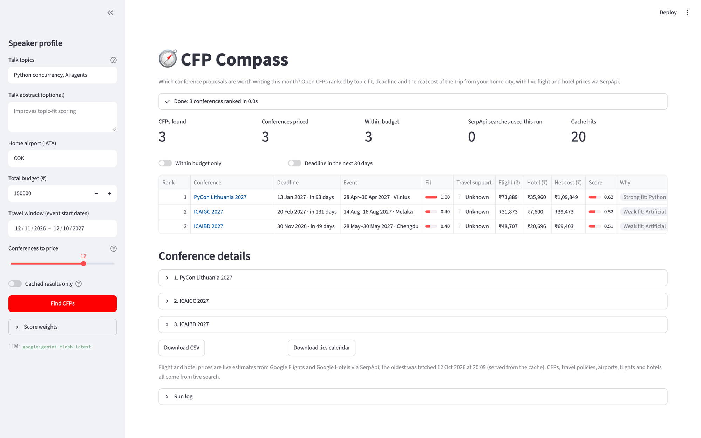
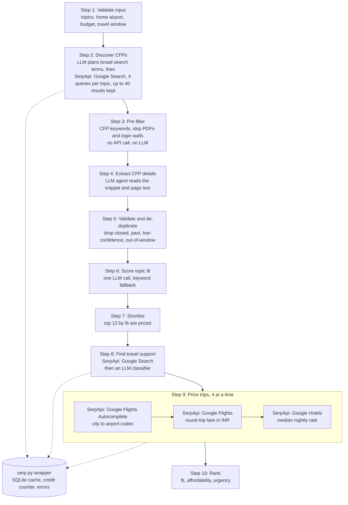

# CFP Compass

CFP Compass finds open conference calls for proposals (CFPs) that match your talk topics and shows what each trip would really cost from your home city, in one ranked table.

Built for the SerpApi India Hackathon 2026, AI Agents track.



## The problem and the insight

CFPs are spread across Sessionize, Pretalx and hundreds of conference websites, so finding the open ones that fit your talk takes hours. For a speaker in India, the deciding question is often not "will I get in?" but "if I get accepted, what will the trip cost me?" CFP Compass answers both at once: it finds open CFPs that match your topics and prices each trip with live flight fares, live hotel rates and the conference's own speaker travel policy.

## Demo video

**Demo video: TODO add link**

## How CFP Compass uses SerpApi

Every search result and every price in CFP Compass comes from SerpApi. Four engines are used, and Google Search does two different jobs.

| Engine | What it does here | Why the product cannot work without it |
| --- | --- | --- |
| **Google Search** (`engine=google`): CFP discovery | First, one cached LLM call turns each talk topic into the broad term conferences use ("Python concurrency" becomes "Python"). Then 4 queries per term (up to 2 topics): `"call for proposals" <term> conference <year>`, `"call for papers" <term> conference <year>`, `site:sessionize.com <term>`, `site:pretalx.com <term> cfp`. `<year>` is this year and next (`2026 OR 2027`) until June, and next year only from July, when this year's calls have mostly closed. Reads `organic_results[]` (title, link, snippet, date). `hl=en`, `gl=us`. | CFPs have no shared feed or API. They live on Sessionize, Pretalx and individual conference sites, and web search is the only way to find them all in one place. |
| **Google Search** (`engine=google`): speaker travel policy | One query per priced conference, for example `"PyCon US" speaker travel OR "travel grant" OR "financial aid"`. The top 5 results go to an LLM that classifies the policy as covered, partial, grant available, none or unknown. | Travel support can change the net cost from the full trip price to ₹0. Each conference writes its policy on its own pages in its own words, so it has to be searched for. |
| **Google Flights Autocomplete** (`engine=google_flights_autocomplete`) | Turns the event city (for example `Porto, Portugal`) into Google's city ID (kgmid) and the city's airport IATA codes. `exclude_regions=true`. | Google Flights needs airport codes, but the city comes from free text on a web page. Without this step no flight can be priced. |
| **Google Flights** (`engine=google_flights`) | Round-trip economy fare for 1 adult from your home airport to all of the city's airports. Flies out the day before the event and back the day after. `currency=INR`, `gl=in`. Reads `price_insights.lowest_price`, else the cheapest price in `best_flights[]` and `other_flights[]`. | For a speaker flying from India, the flight is usually the largest cost. It must be a live fare for the real dates, not an average. |
| **Google Hotels** (`engine=google_hotels`) | `hotels near <venue>, <city>, <country>` (venue when known) for the same nights, `currency=INR`, `gl=in`. Takes the median of the first 10 `rate_per_night.extracted_lowest` values and multiplies it by the number of nights. | The hotel is the other half of the trip cost, and it depends on the city and the exact dates. |

### The shared wrapper

Every SerpApi request goes through one function, `search()` in [`cfp_compass/serp.py`](cfp_compass/serp.py). It does three things:

- **Cache.** The cache key is the SHA-256 of the request parameters, sorted by key, with `api_key` removed. The full JSON response and a timestamp are stored in a local SQLite file (`.cache/cfp_compass.sqlite3`). Discovery and travel-policy searches expire after 24 hours, flights and hotels after 6 hours, and airport lookups never expire.
- **Credit counter.** Each real request that SerpApi answers is counted. The app shows the total as "SerpApi searches used this run", with cache hits shown separately.
- **Graceful errors.** Google searches through SerpApi can take 30 seconds, so requests time out after 90 seconds and are retried once after a timeout, connection error or 5xx (a search that timed out on our side has usually finished at SerpApi, so the retry is served free from SerpApi's 1-hour cache). Identical searches running in parallel (two conferences in one city) wait for each other, so they cost one credit. After that, an `error` key in the response or any exception is logged, the affected field shows "unavailable" with a reason, and the run continues. One failed lookup never stops a run. If SerpApi answers 401, 403 or 429, or says the account has run out of searches, the rest of the run uses cached results only. The API key is removed from every error message before it is shown or logged.

### Credit budget

With the defaults (2 topics, 12 conferences to price):

| Step | Engine | First run | Re-run, same inputs | Cache lifetime |
| --- | --- | --- | --- | --- |
| Discovery | Google Search | 8 (4 per topic) | 0 | 24 h |
| Travel policy | Google Search | 12 (1 per priced conference) | 0 | 24 h |
| Airports | Google Flights Autocomplete | up to 12 (1 per new city) | 0 | never expires |
| Flights | Google Flights | 12 | 0 | 6 h |
| Hotels | Google Hotels | 12 | 0 | 6 h |
| **Total** | | **about 56** | **0** | |

A run uses fewer searches when an event is online, in your home city, has no published dates, or is more than 330 days away (only the airport lookup, cached forever, is made for those; no flight or hotel search). A city whose "city, country" lookup finds nothing gets one more lookup with the city name alone. With "Conferences to price" at 15, a first run uses about 68. Only the best-fitting conferences are priced, and only after the fit filter, so the credit cost does not grow with the number of search results.

## Architecture



Steps 2, 4, 8 and 9 run 4 requests in parallel. LLM results (steps 2, 4, 6 and 8) are cached in the same SQLite file, so a re-run with the same inputs makes no LLM calls either.

| File | Responsibility |
| --- | --- |
| [`app.py`](app.py) | Streamlit UI only: sidebar, progress panel, results table, filters, downloads. No business logic. |
| [`cfp_compass/pipeline.py`](cfp_compass/pipeline.py) | Runs the ten steps, reports progress, and provides the command-line interface. |
| [`cfp_compass/serp.py`](cfp_compass/serp.py) | The only module that calls SerpApi: cache, credit counter, error handling, key scrubbing. |
| [`cfp_compass/cache.py`](cfp_compass/cache.py) | SQLite key/value cache with timestamps. |
| [`cfp_compass/discover.py`](cfp_compass/discover.py) | Steps 2 and 3: discovery queries, URL de-duplication, keyword pre-filter. |
| [`cfp_compass/extract.py`](cfp_compass/extract.py) | Step 4: page fetching and the CFP extraction agent. |
| [`cfp_compass/dedupe.py`](cfp_compass/dedupe.py) | Step 5: validation rules and duplicate merging. |
| [`cfp_compass/fit.py`](cfp_compass/fit.py) | Step 6: topic-fit scoring with an LLM, keyword fallback. |
| [`cfp_compass/enrich.py`](cfp_compass/enrich.py) | Step 8: travel-policy search and classification. |
| [`cfp_compass/costs.py`](cfp_compass/costs.py) | Step 9: airports, flight fare, hotel rate, trip dates. |
| [`cfp_compass/scoring.py`](cfp_compass/scoring.py) | Step 10: net cost, scores, reasons, ranking. Pure functions. |
| [`cfp_compass/llm.py`](cfp_compass/llm.py) | Builds the Pydantic AI agents; LLM cache, rate-limit backoff, call counting. |
| [`cfp_compass/models.py`](cfp_compass/models.py) | Pydantic models: speaker profile, CFP, travel support, trip cost, ranked row, run stats. |
| [`cfp_compass/calendar_export.py`](cfp_compass/calendar_export.py) | Builds the `.ics` file of CFP deadlines. |
| [`cfp_compass/config.py`](cfp_compass/config.py) | Reads `.env`, picks the LLM model, explains missing keys. |
| [`cfp_compass/context.py`](cfp_compass/context.py) | Per-run state: cache, counters, errors, cached-only flag. |

## Setup

### Prerequisites

- Python 3.11 or newer.
- A SerpApi key: <https://serpapi.com/manage-api-key>.
- One LLM key: Gemini, Anthropic or OpenAI.

### Install

macOS / Linux:

```bash
git clone https://github.com/meet244/serp-api-hackathon.git
cd serp-api-hackathon
python3 -m venv .venv
source .venv/bin/activate
pip install -r requirements.txt
cp .env.example .env
```

Windows (PowerShell):

```powershell
git clone https://github.com/meet244/serp-api-hackathon.git
cd serp-api-hackathon
python -m venv .venv
.venv\Scripts\Activate.ps1
pip install -r requirements.txt
copy .env.example .env
```

In `cmd.exe`, activate with `.venv\Scripts\activate.bat` instead.

### Add your keys

Open `.env` and fill in `SERPAPI_API_KEY` and at least one LLM key:

| Variable | Required | Notes |
| --- | --- | --- |
| `SERPAPI_API_KEY` | Yes | From <https://serpapi.com/manage-api-key>. |
| `GEMINI_API_KEY` | One LLM key | Uses `google:gemini-flash-latest`. `GOOGLE_API_KEY` also works. |
| `ANTHROPIC_API_KEY` | One LLM key | Uses `anthropic:claude-haiku-5-5`. |
| `OPENAI_API_KEY` | One LLM key | Uses `openai:gpt-4.1-mini`. |
| `CFP_COMPASS_MODEL` | No | Any Pydantic AI model string, for example `google:gemini-flash-latest`. A bare `gemini-...`, `claude-...` or `gpt-...` name gets its provider prefix added. Overrides the automatic choice. |
| `CFP_COMPASS_CACHE` | No | Path of the cache file. Default: `.cache/cfp_compass.sqlite3`. |

If more than one LLM key is set, the first one found is used, in this order: Anthropic, Gemini, OpenAI. The sidebar shows the model in use.

If a required key is missing, the app stops at startup with a "Setup needed" message that names the missing variable. The command line prints `Configuration error: ...` and exits with code 2.

### Check your SerpApi key

```bash
python -m cfp_compass search "python conference call for papers"
```

This uses 1 search and needs only the SerpApi key. It prints 5 result titles with their links, then `SerpApi searches used: 1 · cache hits: 0`. Run the same command again: it prints `SerpApi searches used: 0 · cache hits: 1 (served from cache)`. If the key is wrong, it prints `Search failed:` followed by SerpApi's error message.

### Run the app

```bash
streamlit run app.py
```

Streamlit opens the app in your browser (by default at <http://localhost:8501>).

### Credits

- A first full run uses about 56 searches.
- A re-run with the same inputs uses none, as long as the cache is still fresh (6 hours for prices, 24 hours for searches).
- The SerpApi free plan has 250 searches per month, and SerpApi also applies an hourly throughput limit (shown on your dashboard). If SerpApi answers 429, the app switches to cached results for the rest of that run. Run it again later: everything already cached is reused, and only the missing lookups spend credits. Lowering "Conferences to price" to 10 brings a first run to about 48 searches.

## Usage

### Sidebar inputs

| Input | Default | Notes |
| --- | --- | --- |
| Talk topics | empty | Comma-separated, at most 2. |
| Talk abstract | empty | Optional. Improves topic-fit scoring. |
| Home airport (IATA) | `COK` | A 3-letter airport code. |
| Total budget (₹) | 1,50,000 | Your budget for flight + hotel. |
| Travel window | 1 to 12 months from today | Events must start inside it. |
| Conferences to price | 12 | 5 to 15. Only this many best-fitting conferences are priced. |
| Score weights | fit 0.45, affordability 0.35, urgency 0.20 | Normalised to sum to 1. Changing them re-ranks the table instantly, with no new searches. |
| Cached results only | off | Never calls SerpApi. See below. |

The profile inputs sit in a form, so editing them never interrupts a search in progress. Click **Find CFPs**. A status panel shows each step as it runs, for example "Step 4 of 10: Extracted 12 of 27 candidates".

### Demo profile

A Kochi-based Python speaker:

- Talk topics: `Python concurrency, AI agents`
- Home airport: `COK`
- Budget: ₹1,50,000
- Travel window: the next 12 months (the default window, 1 to 12 months from today)

### Results

A summary row shows: CFPs found, conferences priced, within budget, SerpApi searches used this run, and cache hits.

| Column | What it shows |
| --- | --- |
| Rank | Position by score. |
| Conference | Conference name, linked to its CFP page. |
| Deadline | CFP deadline and "in N days". "AoE" is shown when the deadline is Anywhere on Earth. |
| Event | Event dates and city, or "Online". |
| Fit | Topic fit from 0 to 1, as a bar. |
| Travel support | Covered, Partial, Grant available, None or Unknown. |
| Flight (₹) | Cheapest round-trip economy fare, or "unavailable". |
| Hotel (₹) | Median nightly rate times the number of nights. |
| Net cost (₹) | Flight + hotel after travel support, with an "Over budget" badge when it is above your budget. |
| Score | Final score from 0 to 1. |
| Why | 2 to 4 short reasons, for example "Deadline in 9 days" or "Over budget by ₹18,000". |

Below the table, each conference has a details section: the deadline evidence quoted from the source, the CFP and submit links, the travel-policy note and its source link, the airports used, the trip dates, hotel nights and median nightly rate, and the reason when a price is unavailable. Open CFPs that were not priced (lower fit) are listed in a separate section. The footer says when the prices were fetched. A "Run log" section lists each step, the counts and any errors.

**Filters:** "Within budget only" keeps rows whose net cost is known and within budget. "Deadline in the next 30 days" keeps rows whose deadline is 0 to 30 days away.

**Downloads** (both contain the rows currently shown):

- **CSV** with every table column and the CFP link.
- **.ics calendar** with one all-day event per CFP deadline, titled `CFP closes: <conference name>`. The description has the submit link, the net cost and the travel support status. Each event has reminders 7 days and 1 day before, and a stable ID per conference. The file can be imported into Google Calendar.

### Cached results only

With the "Cached results only" toggle on, the app never calls SerpApi and spends no credits. It uses whatever is in the cache, even entries older than their normal expiry, and shows when they were fetched. Anything not in the cache shows as "unavailable".

The app switches to this mode by itself when SerpApi returns 401, 403 or 429, or says the account has run out of searches. The rest of the run uses cached data, a banner explains why, and the toggle is turned on for the next run. Turn it off to go back to live searches.

### What "SerpApi searches used this run" counts

It counts the requests that SerpApi actually answered during this run: cache misses only. Cache hits are shown next to it and cost nothing. Requests that fail with an HTTP error, a timeout or a connection error are not counted. A Google "no results" answer is counted, because SerpApi bills it.

### When something goes wrong

| Situation | What happens |
| --- | --- |
| A key is missing from `.env` | The app stops at startup and names the missing variable. |
| Invalid input (airport code, no topics, more than 2 topics, reversed window) | A clear message is shown and nothing runs. |
| SerpApi returns 401, 403, 429 or "run out of searches" | Banner; the rest of the run uses cached results only. |
| One SerpApi lookup fails (timeout, connection error) | That value shows "unavailable" with a reason; the run continues; the error is listed in the run log. |
| No flight results, but a hotel price | Flight "unavailable"; trip marked partial (and the other way round). |
| Event more than 330 days away | "Fares not yet published". No flight or hotel search is made. |
| Event dates not published | Trip "unavailable: Event dates not published". |
| The LLM returns invalid output | Pydantic AI asks it to fix the output twice; then that candidate is skipped and counted as an error. |
| The LLM provider returns 429 or 5xx | A lighter sibling model is tried first (for Gemini: `gemini-flash-lite-latest`, then `gemini-2.5-flash`). Then it waits, using the provider's own retry hint when given (up to 60 s), up to 4 times. If the quota is gone, the rest of the run stops calling the LLM and a banner says so; cached LLM answers are still used. |
| Topic-fit LLM call fails | Falls back to keyword overlap. |
| A page fetch times out or is blocked | Extraction uses the search snippet only. |

### Command line

The same pipeline runs from the terminal and prints the ranked table:

```bash
python -m cfp_compass run --topics "Python concurrency, AI agents" --home COK --budget 150000
python -m cfp_compass run --topics "Python concurrency, AI agents" --home COK --budget 150000 \
    --cached-only --json out.json --ics out.ics
```

| Option | Meaning |
| --- | --- |
| `--topics` | Required. Comma-separated, at most 2. |
| `--abstract` | Optional talk abstract. |
| `--home` | Home airport IATA code. Default `COK`. |
| `--budget` | Budget in INR. Default `150000`. |
| `--from`, `--to` | Travel window as `YYYY-MM-DD`. Default: 1 to 12 months from today. |
| `--max` | Conferences to price. Default `12`. |
| `--cached-only` | Never call SerpApi; use cached responses only. |
| `--json out.json` | Also write the full result as JSON. |
| `--ics out.ics` | Also write the CFP deadlines as an `.ics` calendar. |
| `-v` | Verbose logging. |

## Design decisions and limitations

### Cost and caching

- Every SerpApi call goes through one cached wrapper. Only the 12 best-fitting conferences are priced, and only after topic fit is scored.
- Discovery searches for broad terms, not niche talk topics: CFP pages say "Python", rarely "Python concurrency". One cached LLM call plans the terms; topic fit still uses your full topics and abstract.
- Each discovery query covers this year and next year with `OR` until June, and next year only from July. There are 4 queries per topic (8 in total). Sessionize speaker profiles are skipped by the pre-filter.
- LLM results are cached in the same SQLite file: extraction for 72 hours (by URL), topic fit and travel classification for 24 hours. A re-run with the same inputs makes no LLM calls.
- In cached-only mode, expired entries (searches and LLM answers) are still used, with their fetch time. A stale price is more useful than "unavailable". The footer shows the oldest fetch time on the page.
- Google "no results" answers are cached like normal answers, because they are billed.
- Discovery keeps at most 40 results, taken in turn from each query so that every query's best results are kept.
- The pre-filter also skips LinkedIn, X/Twitter, Facebook, Instagram, YouTube and TikTok, which need a login or contain only video.
- A page is fetched only when the snippet mentions fewer than two dates. Page fetches cost no SerpApi credits, and a cached extraction is never fetched again.

### Extraction honesty

- The extraction agent must return a confidence for every record (a missing confidence would silently drop good CFPs), and it is told never to invent a date. A deadline is kept only if its quoted evidence contains a digit or a month name; otherwise the deadline is left blank.
- Invalid LLM output is retried twice (Pydantic AI asks the model to fix it), then the item is skipped and counted as an error. LLM answers are cached, so a re-run gives the same results.
- A travel-support status other than "unknown" must cite one of the search results the model was shown. Otherwise it is downgraded to "unknown". This stops an invented "covered" from ranking a row first.
- The travel-policy search removes the edition year from the conference name, because policy pages often leave it out.
- A submit link from the LLM is used only if it is on the same site as the search result. Otherwise the search result's link is used.
- Records are dropped when the CFP is closed, the deadline has passed, confidence is below 0.5, the event is over, it starts outside your travel window, or it has no city and is not online.
- Records with unknown event dates are kept, with the trip marked "unavailable: Event dates not published".
- Duplicates (for example "PyCon US 2027" and "pycon us") are merged. The higher-confidence record is kept and its missing fields are filled from the other one.

### Pricing rules

- Fly out the day before the event starts and return the day after it ends. The hotel covers the same nights, so nights = event days + 1.
- The airport lookup sends "city, country" when the country is known, falls back to the city alone, and prefers a suggestion that mentions the country.
- Hotel cost is the median of the first 10 nightly rates found, times the number of nights, so one outlier does not change it much.
- Online events and events in your home city cost ₹0, whatever their dates.
- Flights and hotels are not searched when the outbound date is more than 330 days away, so no credits are spent; the trip shows "Fares not yet published". A flight search with no results more than 270 days ahead is also shown as "Fares not yet published".
- Partial travel support is assumed to cover 50% of the trip.

### Scoring

- Final score = 0.45 × fit + 0.35 × affordability + 0.20 × urgency, plus 0.05 when a travel grant is available, kept between 0 and 1. The weights are normalised to sum to 1 when you move the sliders.
- Net cost: covered ₹0; partial 50% of the total; grant available, none or unknown the full total; online ₹0.
- Affordability = 1 − net cost ÷ budget. Over budget gives 0 and an "Over budget" badge. Unknown cost gives a neutral 0.4.
- Urgency rewards deadlines that leave time to write a good proposal: 0 to 1 days 0.2; 2 to 6 days 0.6; 7 to 30 days 1.0; 31 to 60 days 0.7; more than 60 days 0.4; unknown 0.3.
- "Within budget" only counts rows whose net cost is known.

### Limitations

- Prices are live estimates from Google Flights and Google Hotels. They change, and the app does not book anything.
- Fares far ahead may not be published yet, so events many months away often show "Fares not yet published".
- Extraction can miss a CFP or misread a date or city. Check the CFP page before you submit.
- Travel-policy detection reads search result snippets only, not the full policy pages.
- The hotel price is the median of nearby listings, not a quote for a specific hotel.

## Security

- Keys live only in `.env`, which is git-ignored. `.env.example` contains variable names only.
- The SerpApi key is never logged or stored in the cache. The cache key is computed without `api_key`, and every known key value is removed from error messages before they are shown or logged.
- Fetched page text and search results are treated as untrusted data. The LLM instructions say to extract facts from them and never follow instructions inside them.
- Page fetching allows only `http` and `https` URLs on public hosts (checked on every redirect, at most 5 redirects), reads at most 2 MB, and stops after 8 seconds overall.
- Text from the web is escaped before the app displays it, and it cannot close the untrusted-data block in an LLM prompt.
- The cache file (`.cache/`) is git-ignored.

## Running the tests

```bash
pip install -r requirements.txt
python -m pytest
```

The tests never call SerpApi or an LLM, and they need no `.env` file. SerpApi is replaced by a fake client, the LLM by Pydantic AI's `FunctionModel`, and page fetches are patched out. Tests that need a cache get a temporary SQLite file and a fixed date (12 Oct 2026). The fixtures in [`tests/fixtures`](tests/fixtures) are SerpApi documentation example responses for Google Search, Google Flights, Google Flights Autocomplete and Google Hotels.

## AI tools used

Built with Claude Code (Anthropic's coding agent, model Claude Opus 5.5) from a written build spec; Claude was also used to plan the spec. At runtime CFP Compass calls an LLM through Pydantic AI (Gemini, Claude or OpenAI, whichever key you provide) to extract CFP details, score topic fit and classify travel policies.

## License

MIT. See [LICENSE](LICENSE).
